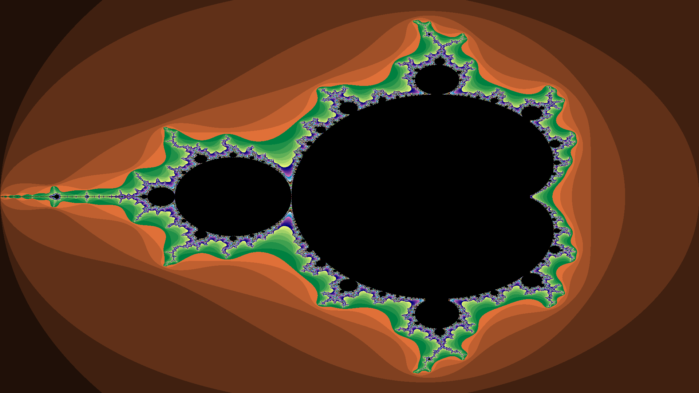
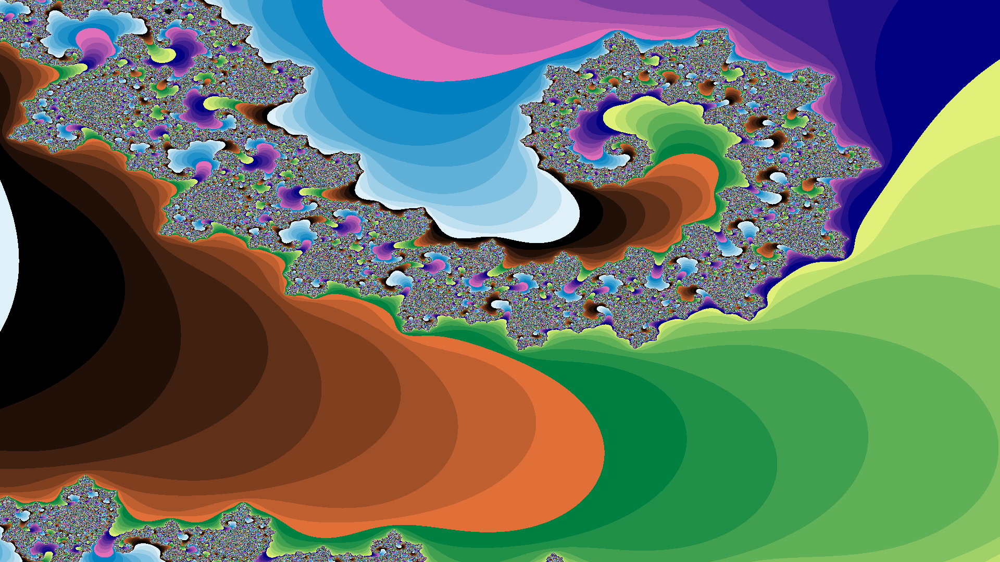

# Parallel Generation of the Mandelbrot Set using OpenMP

A high-performance C implementation of the Mandelbrot set using OpenMP parallelization and algorithmic optimizations. The program generates PNG images of the Mandelbrot fractal, supporting custom zoom levels and coordinates for exploring different regions of the complex plane.

## Features

- **OpenMP Parallelization:** Distributes computation across multiple CPU threads using OpenMP.
- **Two-Pass Boundary Algorithm:** Divides the image into 16×16 pixel cells, evaluating only the four corners before determining whether the remaining pixels can be filled with a uniform colour.
- **Mathematical Pre-checks:** Uses the main cardioid and period-2 bulb equations to bypass unnecessary iterations for points known to be inside the Mandelbrot set.
- **Optimized Escape Time Algorithm:** Uses squared magnitude comparisons and temporary variables to reduce computational overhead.
- **Dynamic Load Balancing:** Uses OpenMP dynamic scheduling to distribute computationally expensive boundary regions across available threads.
- **Custom Fractal Exploration:** Supports configurable zoom levels and coordinates within the complex plane.
- **PNG Output:** Generates images at 1920×1080 resolution.

## Requirements

- GCC compiler
- OpenMP support
- Linux environment (tested on Ubuntu 24.04 LTS)

## Compilation

Compile the program using GCC with OpenMP support and compiler optimizations:

```bash
gcc -fopenmp -O3 -o mandelbrot mandelbrot.c
```

- `-fopenmp`: Enables OpenMP parallelization.
- `-O3`: Enables aggressive compiler optimizations.

## Usage

The program accepts command-line arguments to configure the output image and the region of the Mandelbrot set being explored.

```bash
./mandelbrot <output.png> <zoom> [real] [imaginary]
```

| Argument | Description |
|---|---|
| `output.png` | Name of the generated PNG image. |
| `zoom` | Zoom multiplier applied to the default view. |
| `real` | Optional real component of the target coordinate. |
| `imaginary` | Optional imaginary component of the target coordinate. |

### Examples

**Standard Full View**

```bash
./mandelbrot fullview.png 1
```


**Seahorse Valley**

```bash
./mandelbrot seahorse.png 1000 -0.7436438870 0.1318259042
```


**Deep Void**

```bash
./mandelbrot void.png 2000 -0.1984584369 1.1002709224
```


**Empty Space**

```bash
./mandelbrot empty.png 10 -1.2338866889 -0.7041311504
```


## OpenMP Thread Configuration

The number of threads can be configured through the `OMP_NUM_THREADS` environment variable without recompiling the program.

```bash
# Run using 4 threads
OMP_NUM_THREADS=4 ./mandelbrot output.png 1

# Run using 8 threads
OMP_NUM_THREADS=8 ./mandelbrot output.png 1

# Run using 12 threads
OMP_NUM_THREADS=12 ./mandelbrot output.png 1
```

## Algorithm Overview

### 1. Escape Time Algorithm

The Mandelbrot set is generated by iterating the function:

\[
z_{n+1} = z_n^2 + c
\]

For each pixel, the corresponding complex coordinate is evaluated until its magnitude exceeds 2 or the maximum iteration count is reached.

The squared magnitude is used to avoid unnecessary square root calculations:

\[
z_r^2 + z_i^2 > 4
\]

Points that do not escape within the maximum iteration count are classified as belonging to the set and coloured black.

### 2. Mathematical Pre-checks

Before performing the iterative calculations, two mathematical checks identify points known to be inside the Mandelbrot set:

- **Main Cardioid:** Identifies points within the central cardioid.
- **Period-2 Bulb:** Identifies points within the circular bulb centred at -1 on the real axis.

These checks eliminate unnecessary iterations for large regions of the image.

### 3. Two-Pass Boundary Algorithm

Instead of calculating every pixel independently, the image is divided into 16×16 pixel cells.

**Pass 1 – Corner Evaluation**
- Calculates the escape iteration count for the four corners of each cell.

**Pass 2 – Cell Classification**
- If all four corners have identical iteration counts, the remaining pixels are filled with the same colour.
- If the corners differ, the cell is evaluated using the standard per-pixel escape time algorithm.

This significantly reduces the number of mathematical operations required in uniform regions.

### 4. OpenMP Parallelization

OpenMP distributes the workload across multiple CPU threads.

- `collapse(2)` combines the two-dimensional image iteration space into a single parallel iteration space.
- `schedule(static)` is used for Pass 1 because corner evaluations are uniformly distributed.
- `schedule(dynamic)` is used for Pass 2 to mitigate load imbalance caused by varying iteration counts between cells.

## Performance Testing

The implementation was tested at 1920×1080 resolution across four different regions of the Mandelbrot set:

| Test Region | Description |
|---|---|
| Standard View | The default view containing the entire Mandelbrot set. |
| Seahorse Valley | A complex boundary region requiring extensive iteration. |
| Deep Void | A region deep inside the set containing a smaller Mandelbrot structure. |
| Empty Space | A region completely outside the set, testing uniform cell detection. |

Each configuration was executed five times, and average execution times were recorded.

The following table compares the brute-force implementation against the optimized two-pass algorithm:

| Region | Brute Force (1 Thread) | Two-Pass (1 Thread) | Brute Force (12 Threads) | Two-Pass (12 Threads) |
|---|---:|---:|---:|---:|
| Standard View | 163 ms | 79 ms | 72 ms | 11 ms |
| Seahorse Valley | 418 ms | 291 ms | 94 ms | 32 ms |
| Deep Void | 2010 ms | 336 ms | 287 ms | 40 ms |
| Empty Space | 50 ms | 4 ms | 72 ms | 5 ms |

The results demonstrate the benefits of combining algorithmic optimizations with parallel execution. The two-pass algorithm significantly reduces redundant calculations in uniform regions, while OpenMP improves performance when evaluating complex fractal boundaries.

## Configuration

The implementation uses several predefined constants that can be modified to adjust performance and rendering behaviour.

| Constant | Default Value | Description |
|---|---:|---|
| `WIDTH` | 1920 | Output image width. |
| `HEIGHT` | 1080 | Output image height. |
| `MAX_ITER` | 1000 | Maximum iterations per pixel. |
| `GRID_SIZE` | 16 | Width and height of each two-pass cell. |

Increasing the grid size can improve performance in uniform regions but may introduce visual artifacts by missing smaller fractal features. Decreasing it improves boundary accuracy at the cost of additional computational overhead.

Increasing `MAX_ITER` can improve detail in deeper zooms but also increases worst-case computation time.

## References

- [3Blue1Brown – Beyond the Mandelbrot Set: An Intro to Holomorphic Dynamics](https://youtu.be/LqbZpur38nw)
- [Mandelbrot Set Explorer](https://mandelbrot.site)
- [Wikipedia – Mandelbrot Set](https://en.wikipedia.org/wiki/Mandelbrot_set)
- [Wikipedia – Plotting Algorithms for the Mandelbrot Set](https://en.wikipedia.org/wiki/Plotting_algorithms_for_the_Mandelbrot_set)

---

**Technologies:** C · OpenMP · GCC · Linux
